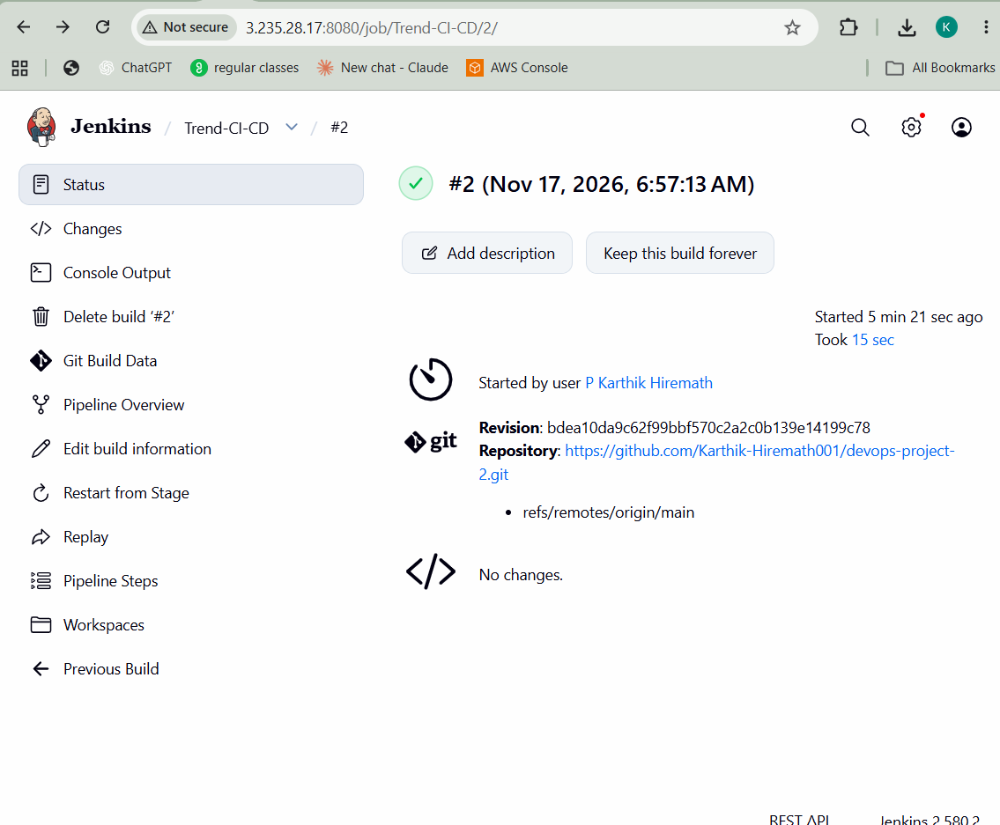
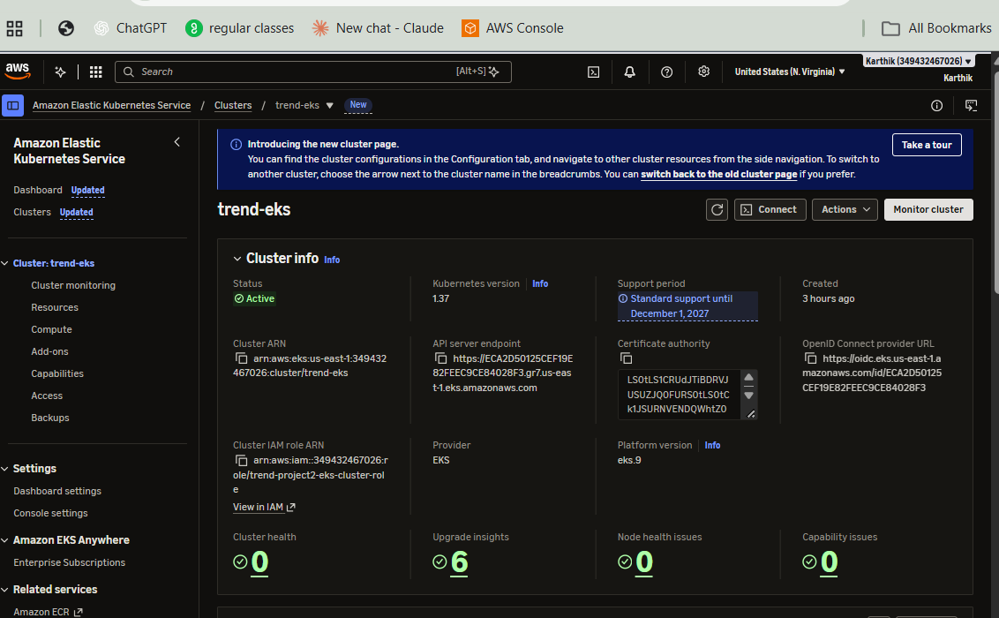

# Trend Application – DevOps CI/CD Project

## 1. Project Overview

This project demonstrates the end-to-end deployment of a production-ready static web application using DevOps tools and AWS cloud infrastructure.

The application is containerized using Docker, infrastructure is provisioned using Terraform, and the CI/CD pipeline is implemented using Jenkins. The application is deployed to an Amazon EKS Kubernetes cluster and exposed through an AWS LoadBalancer.

## 2. Technologies Used

- **Cloud:** AWS
- **Infrastructure as Code:** Terraform
- **Containerization:** Docker
- **Container Registry:** Docker Hub
- **CI/CD:** Jenkins
- **Container Orchestration:** Kubernetes (Amazon EKS)
- **Version Control:** Git and GitHub
- **Web Server:** Nginx

## 3. Project Architecture

1. Source code is maintained in GitHub.
2. Jenkins checks out the repository.
3. Jenkins builds a Docker image using the Dockerfile.
4. The image is pushed to Docker Hub.
5. Jenkins connects to the Amazon EKS cluster.
6. Kubernetes deploys the application using Deployment and Service manifests.
7. The application is exposed externally through an AWS LoadBalancer.

## 4. AWS Infrastructure

Terraform is used to provision the required infrastructure in the **US East (N. Virginia) – us-east-1** region.

Infrastructure components include:

- Custom VPC
- Public subnets across two Availability Zones
- Internet Gateway and route table
- IAM roles and policies
- Jenkins EC2 instance
- Amazon EKS cluster
- EKS managed worker node group
- Security groups and access configurations

Terraform configuration files are maintained in the `terraform/` directory.

## 5. Docker Configuration

The application is packaged using Docker with Nginx as the web server.

The Dockerfile copies the production-ready files from the `dist/` directory into the Nginx web root.

Docker image repository:

`karthikops/trend-app`

Images are tagged using Jenkins build numbers.

## 6. Jenkins CI/CD Pipeline

A declarative Jenkins pipeline is defined in the `Jenkinsfile`.

### Pipeline stages

1. **Checkout:** Retrieves the project from GitHub.
2. **Build Docker Image:** Builds the application image.
3. **Push to Docker Hub:** Authenticates and pushes the image to Docker Hub.
4. **Deploy to EKS:** Updates kubeconfig and applies Kubernetes manifests.
5. **Verify Deployment:** Checks rollout status, running pods and Kubernetes Service.

Docker Hub credentials are stored securely in Jenkins Credentials.

AWS access is provided through the IAM role attached to the Jenkins EC2 instance.

## 7. Kubernetes Deployment

Kubernetes configuration files are maintained in the `k8s/` directory.

- `deployment.yaml` – Defines the application Deployment, container image, replicas and resource limits.
- `service.yaml` – Exposes the application using a LoadBalancer Service.

The application is deployed to Amazon EKS and exposed through an AWS-managed external LoadBalancer.

## 8. Repository Structure

```text
Trend/
├── dist/
├── terraform/
│   ├── main.tf
│   ├── iam.tf
│   ├── security.tf
│   ├── jenkins.tf
│   ├── eks.tf
│   ├── variables.tf
│   ├── outputs.tf
│   └── versions.tf
├── k8s/
│   ├── deployment.yaml
│   └── service.yaml
├── screenshots/
│   ├── Devops-project2.1.png
│   ├── Devops-project2.2.png
│   └── Devops-project2.3.png
├── Dockerfile
├── .dockerignore
├── .gitignore
└── Jenkinsfile
```

## 9. Deployment Evidence

### Screenshot 1 – Application and deployment


### Screenshot 2 – CI/CD pipeline



### Screenshot 3 – AWS and Kubernetes deployment



## 10. Setup and Execution

### Prerequisites

- AWS account with appropriate permissions
- AWS CLI
- Terraform
- Docker
- Git
- kubectl
- Jenkins
- Docker Hub account

### Clone the repository

```bash
git clone https://github.com/Karthik-Hiremath001/devops-project-2.git
cd devops-project-2
```

### Provision infrastructure

```bash
cd terraform
terraform init
terraform fmt
terraform validate
terraform plan
terraform apply
```

Configure the required local Terraform variables before applying.

### Build the Docker image

From the project root:

```bash
docker build -t karthikops/trend-app:latest .
```

### Deploy to Kubernetes

Configure kubectl access to the EKS cluster, then run:

```bash
kubectl apply -f k8s/
```

Check deployment status:

```bash
kubectl get deployments
kubectl get pods
kubectl get services
```

### Run the CI/CD pipeline

Configure the Jenkins Pipeline job to use this GitHub repository and the `Jenkinsfile`.

Run the pipeline to build, push and deploy the application.

## 11. Security and Cost Considerations

- AWS credentials are not stored in the Git repository.
- Jenkins uses IAM roles for AWS access.
- Docker Hub credentials are stored in Jenkins Credentials.
- Terraform state files and local variable files are excluded from version control.
- Security group access is restricted where applicable.
- AWS resources should be stopped, scaled down or deleted when they are no longer required to avoid unnecessary charges.

## 12. Project Outcome

Successfully implemented an end-to-end DevOps deployment workflow using Terraform, Docker, Jenkins, Docker Hub, Kubernetes and Amazon EKS.

The Jenkins pipeline successfully built the Docker image, pushed it to Docker Hub, deployed the application to EKS and verified the Kubernetes rollout.
